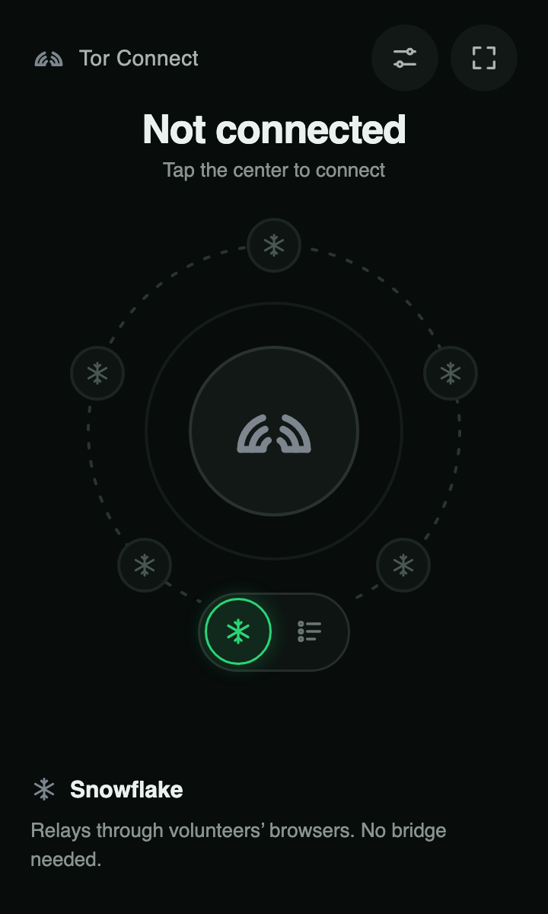
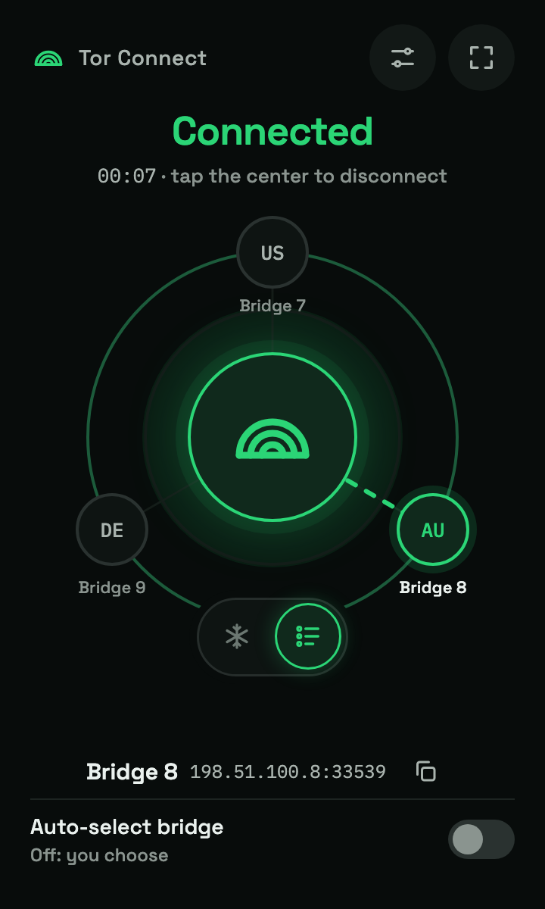

# Tor Connect

Tor Connect is a Chrome extension that routes Chrome through a Tor client running on your computer. Choose Snowflake or add your own Tor bridge lines. Your bridge settings are stored locally in your Chrome profile.

> Tor Connect is not Tor Browser. It does not provide Tor Browser’s fingerprinting protections, and it does not route other apps on your computer through Tor.

## Features

- Connect Chrome through Tor with Snowflake or saved bridge lines.
- Keep bridge lines and connection preferences on your device.
- Choose a bridge manually or let Tor try enabled bridges in order.
- Import bridge lines from a text file or clipboard.
- Check bridge endpoint reachability from your computer.
- Use the interface in dark, light, or system theme.

## Design previews

These images are rendered from the interactive design mockups and show the intended interface. They are design previews, not screenshots of a live extension session.

<p>
  <a href="docs/screenshots/connection-method-mockup.png"></a>
  <a href="docs/screenshots/connected-bridge-mockup.png"></a>
</p>

## Install

The Chrome Web Store listing is not published yet. When it is available, its link will be added here.

The extension’s setup page offers two ways to install the local Tor companion:

1. **Setup wizard:** download the installer for macOS, Windows, or Linux from [GitHub Releases](https://github.com/Tor-Connect/extension/releases). The installer includes a Tor Expert Bundle and registers the helper that connects Chrome to Tor.
2. **Manual installation:** download the Tor Expert Bundle from the [Tor Project](https://www.torproject.org/download/tor/), then use the operating-system instructions in the extension’s setup page. The generated command downloads the small Tor Connect setup script from this repository.

The companion runs Tor locally. Chrome connects to its local SOCKS5 listener after Tor reports that it is ready. The companion is needed because Chrome extensions cannot install or launch a local Tor process by themselves.

## Build from source

For local development, you need Google Chrome, Git, and the Tor Expert Bundle for your operating system.

1. Clone this repository and open `chrome://extensions` in Chrome.
2. Turn on **Developer mode**, choose **Load unpacked**, and select the `extension` directory. Copy the extension ID shown by Chrome.
3. Download and extract the [Tor Expert Bundle](https://www.torproject.org/download/tor/).
4. Run the installer script for your operating system from the repository root, replacing the placeholders with your extension ID and bundle path:

   **macOS (Terminal)**

   ```sh
   ./scripts/install-macos.sh <extension-id> /path/to/extracted/tor-expert-bundle
   ```

   **Linux (Terminal; Python 3 required)**

   ```sh
   ./scripts/install-linux.sh <extension-id> /path/to/extracted/tor-expert-bundle
   ```

   **Windows (PowerShell)**

   ```powershell
   powershell -ExecutionPolicy Bypass -File scripts/install-windows.ps1 -ExtensionId <extension-id> -BundleDirectory "C:\path\to\extracted\tor-expert-bundle"
   ```

5. Restart Chrome, open Tor Connect, and follow the setup page.

If you remove and reload the unpacked extension, Chrome may assign it a different ID. Rerun the installer with the new ID.

## Releases

GitHub Actions builds companion installers for macOS, Windows x64, and Debian/Ubuntu x64. A release is published from qualifying Conventional Commit titles on `main`: `fix:` for a patch, `feat:` for a minor release, and a breaking change such as `feat!:` for a major release. Other commit types run the build workflow without publishing a release.

The build downloads the Tor Expert Bundle version pinned in `installer/tor-expert-bundle-version.txt` and verifies its Tor Project signature before packaging it. The macOS app is ad-hoc signed but not notarized, and the Windows installer is not Authenticode-signed, so those operating systems may show security warnings.

## Privacy

Tor Connect stores your connection preferences, theme, and bridge lines locally. It does not operate a service that receives your browsing history, visited URLs, or bridge lines. Tor traffic still involves Tor relays, bridges, and Snowflake infrastructure, and optional bridge pings contact bridge endpoints directly. Read the [Privacy Policy](PRIVACY.md) for details.

## Uninstall

Disconnect in Tor Connect and remove the extension from `chrome://extensions`. Then remove the native messaging manifest, helper, and local runtime data:

- **macOS:** delete `~/Library/Application Support/TorChrome` and `~/Library/Application Support/Google/Chrome/NativeMessagingHosts/org.torconnect.torchrome.json`.
- **Linux:** if installed from the Debian package, run `sudo apt remove tor-connect-setup`. Then delete `${XDG_DATA_HOME:-~/.local/share}/TorChrome`. For manual setup, also delete `~/.config/google-chrome/NativeMessagingHosts/org.torconnect.torchrome.json`.
- **Windows:** uninstall **Tor Connect Setup** from **Installed apps**, then delete `%LOCALAPPDATA%\TorChrome`. For manual setup, also remove `%LOCALAPPDATA%\Google\Chrome\User Data\NativeMessagingHosts\org.torconnect.torchrome.json` and `HKCU\Software\Google\Chrome\NativeMessagingHosts\org.torconnect.torchrome`.

## Support

Report bugs or ask questions in [GitHub Issues](https://github.com/Tor-Connect/extension/issues). Issues are public; do not post bridge lines, diagnostic logs containing private information, or other sensitive details.
